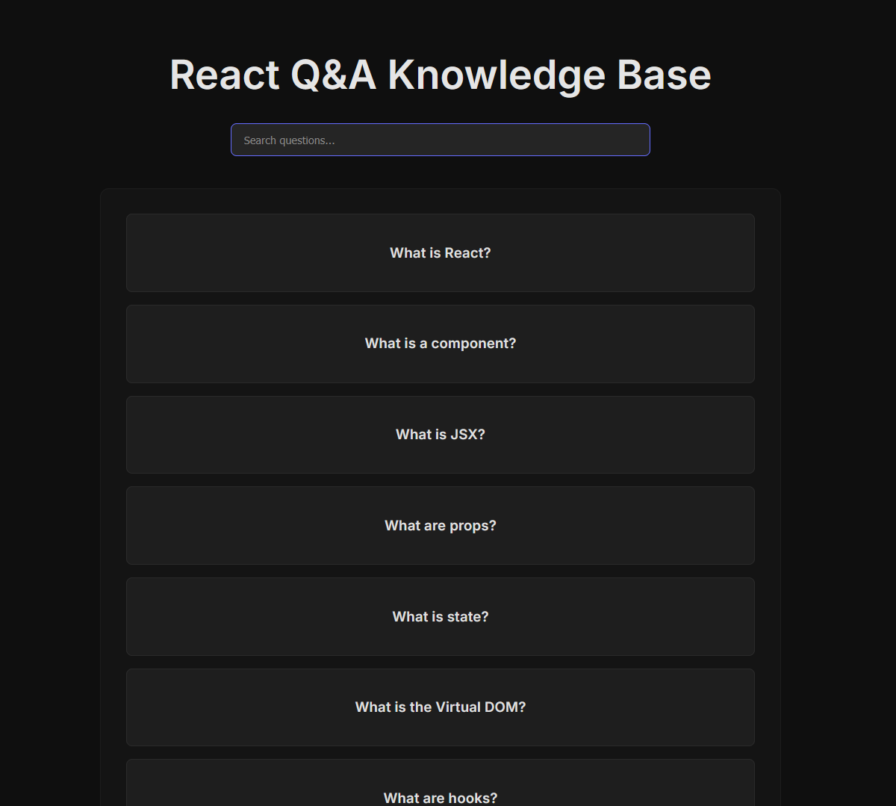
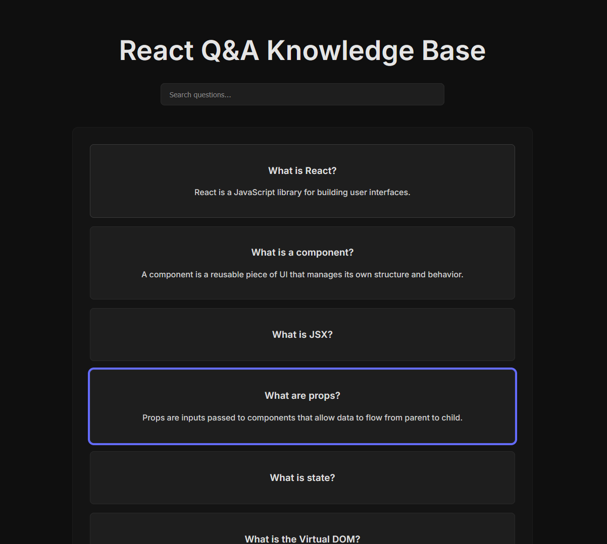

# React Q&A Knowledge Base

A searchable Q&A app covering core React concepts. Type in the search box to filter questions, and click a card to reveal its answer.

**Live demo:** [fixedbits.github.io/react-qa-knowledge-base](https://fixedbits.github.io/react-qa-knowledge-base/)





## Features

- Live search that filters questions as you type, not case-sensitive
- Click a card to open or close its answer
- Keyboard accessible: Tab to a card, then press Enter or Space to toggle it
- Staggered fade-in animation when cards load
- 10 questions on core React concepts, stored in a simple data file that is easy to extend

## Tech Stack

- React (functional components and hooks: useState)
- Vite
- CSS
- GitHub Pages (deployed with gh-pages)

## How to Use

1. Type a keyword in the search box to narrow the list.
2. Click a question, or Tab to it and press Enter, to see the answer.
3. Click again to close it.

## Run Locally

```bash
git clone https://github.com/fixedbits/react-qa-knowledge-base.git
cd react-qa-knowledge-base
npm install
npm run dev
```

Then open the local address shown in the terminal, which ends in /react-qa-knowledge-base/.

## Notes

- Questions and answers live in `src/data/questions.js`. Add a new object with an id, question, and answer to extend the list.
- Each card is a semantic `button`, so keyboard and screen reader users can use it.
- Deployed with `npm run deploy`, which builds the site and publishes the `dist` folder to the `gh-pages` branch.

## Author

Built by [fixedbits](https://github.com/fixedbits) front-end devleoper based in Utah.
